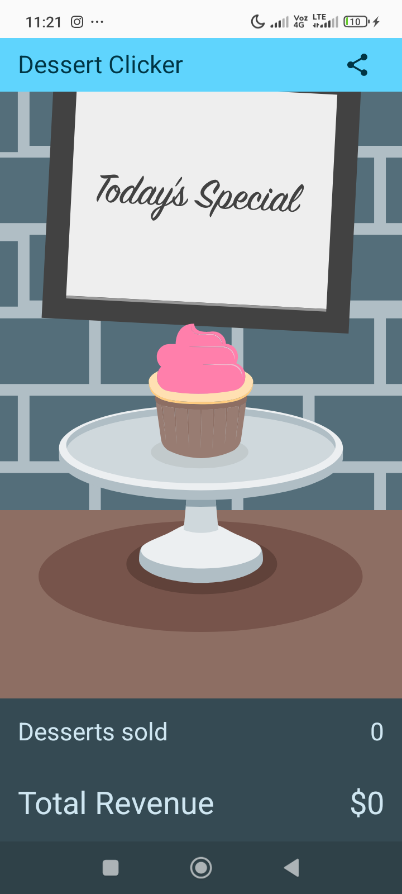
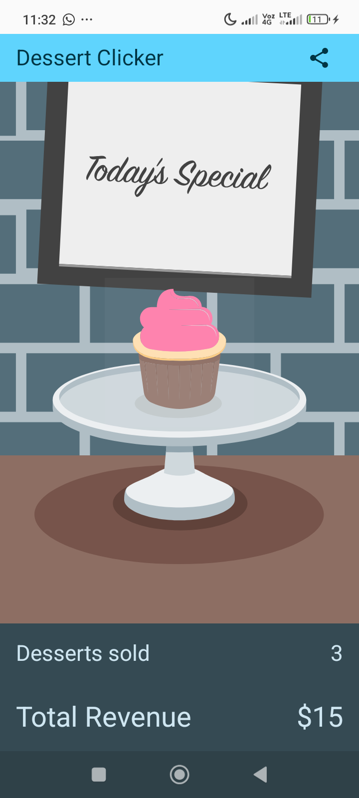
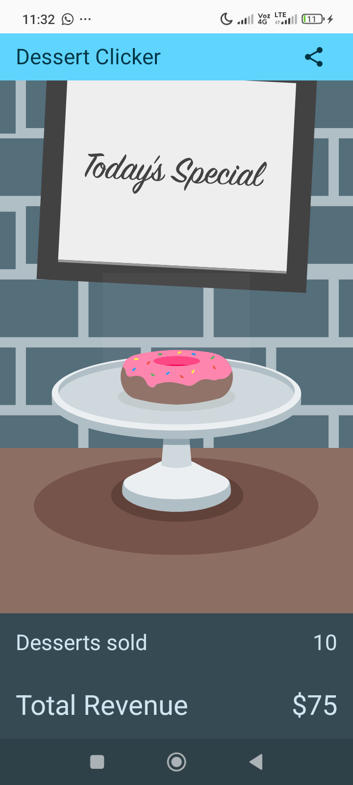
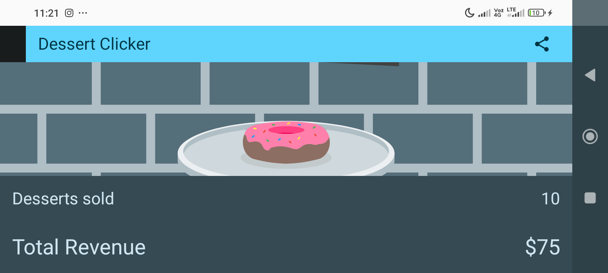
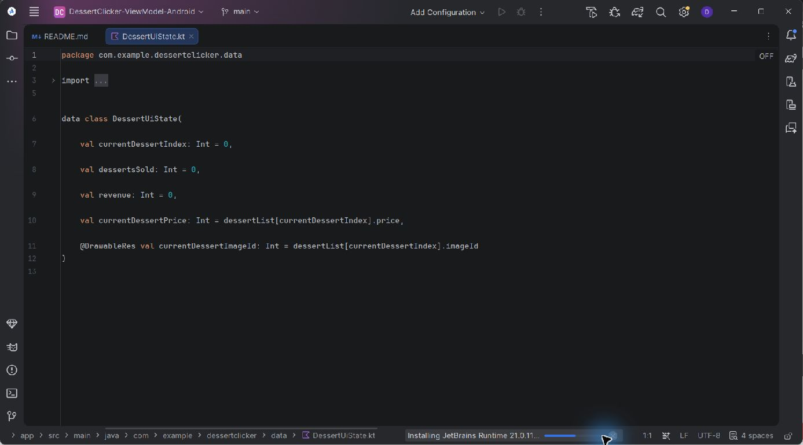
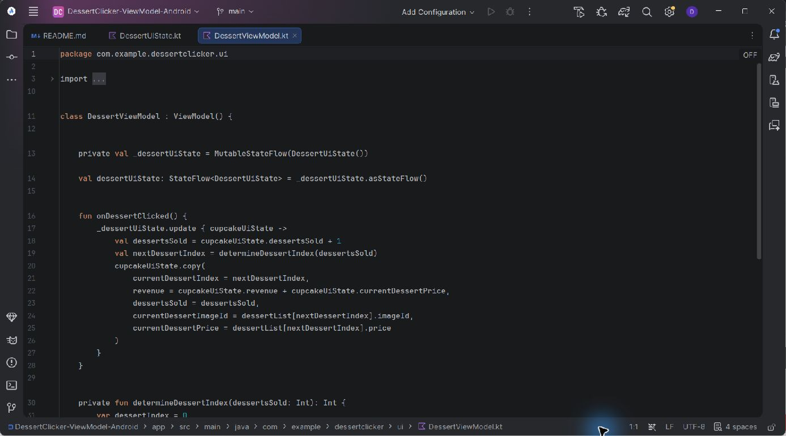
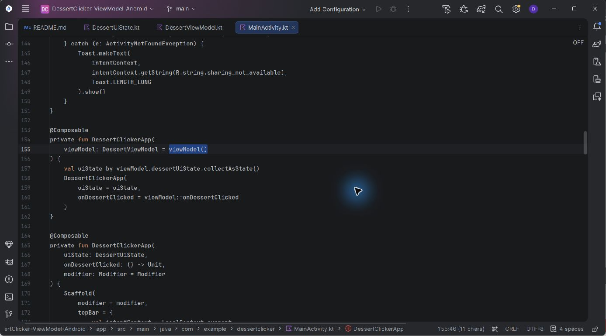

# Dessert Clicker con ViewModel

Segunda práctica de Android desarrollada en Kotlin y Jetpack Compose. El proyecto continúa la primera práctica de ciclo de vida e implementa la arquitectura propuesta en el codelab oficial **[Cómo agregar un ViewModel a Dessert Clicker](https://developer.android.com/codelabs/basic-android-kotlin-compose-practice-viewmodel?hl=es-419)**.

La aplicación incrementa la cantidad de postres vendidos y los ingresos, cambia el postre según el progreso, permite compartir el resultado y conserva el estado al rotar o enviar la actividad a segundo plano.

## Arquitectura implementada

- `DessertUiState`: clase de datos inmutable con el índice, ventas, ingresos, precio e imagen actuales.
- `DessertViewModel`: única fuente de verdad; expone un `StateFlow<DessertUiState>` de solo lectura y procesa cada clic.
- `MainActivity` y Compose: observan el flujo con `collectAsState()`, muestran el estado y remiten los eventos al ViewModel.
- Registros del ciclo de vida: se conservan `onCreate()`, `onStart()`, `onResume()`, `onRestart()`, `onPause()`, `onStop()` y `onDestroy()` con la etiqueta `MainActivity`.

```text
Toque del usuario → onDessertClicked() → MutableStateFlow
                                      ↓
Interfaz Compose ← collectAsState() ← DessertUiState
```

## Archivos principales

- `app/src/main/java/com/example/dessertclicker/data/DessertUiState.kt`
- `app/src/main/java/com/example/dessertclicker/ui/DessertViewModel.kt`
- `app/src/main/java/com/example/dessertclicker/ui/MainActivity.kt`
- `app/build.gradle.kts`

## Ejecución

1. Abre la carpeta raíz en Android Studio.
2. Selecciona un dispositivo Android con API 24 o superior.
3. Ejecuta la configuración `app`.

La comprobación completa también puede ejecutarse desde la raíz:

```powershell
.\gradlew.bat clean testDebugUnitTest lintDebug assembleDebug
```

El APK de depuración se genera en `app/build/outputs/apk/debug/app-debug.apk`.

## Pruebas realizadas en teléfono físico

Las pruebas se ejecutaron el 15 de octubre de 2026 en un Xiaomi 23100RN82L con Android 15 (API 35), conectado por ADB:

- Estado inicial: 0 postres y $0.
- Incremento de ventas e ingresos mediante toques reales.
- Cambio de cupcake a donut al superar el umbral configurado.
- Conservación de 10 postres y $75 después de rotar la pantalla.
- Conservación del estado al ir a Inicio y volver a la aplicación.
- Apertura correcta del selector de compartir con el texto esperado.
- Secuencia de recreación observada en Logcat: `onPause`, `onStop`, `onDestroy`, `onCreate`, `onStart`, `onResume`.
- Compilación, Lint y ensamblado final correctos; Lint informó 0 errores.

El detalle reproducible está en [docs/INFORME_PRUEBAS.md](docs/INFORME_PRUEBAS.md).

## Evidencias

### Estado inicial y ventas

<p align="center">
  
  
  
</p>

### Estado conservado al rotar



### Implementación en Android Studio







## Historial incremental

El repositorio conserva la primera práctica y añade commits independientes para diagnóstico, dependencia de ViewModel, estado de interfaz, creación del ViewModel, traslado de la lógica, integración con Compose, pruebas y documentación. Puede consultarse con:

```bash
git log --oneline --reverse
```

## Comparación con la solución oficial

Se comparó la implementación con la rama `viewmodel` del repositorio oficial de Google. `DessertUiState` coincide con la solución de referencia y el ViewModel mantiene la misma lógica. Se conservaron la configuración moderna de Gradle, Material 3, las mejoras de la primera práctica y los registros del ciclo de vida en lugar de sustituir todo el proyecto por la rama antigua.

## Procedencia y licencia

- [Codelab de ViewModel](https://developer.android.com/codelabs/basic-android-kotlin-compose-practice-viewmodel?hl=es-419)
- [Codelab de ciclo de vida](https://developer.android.com/codelabs/basic-android-kotlin-compose-activity-lifecycle?hl=es-419)
- [Repositorio oficial Dessert Clicker](https://github.com/google-developer-training/basic-android-kotlin-compose-training-dessert-clicker)

El código y los recursos originales conservan sus avisos y la licencia Apache 2.0 incluida en [LICENSE](LICENSE).
